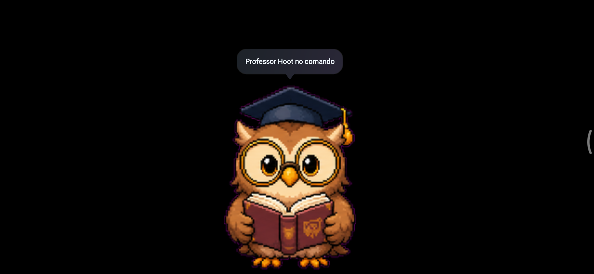
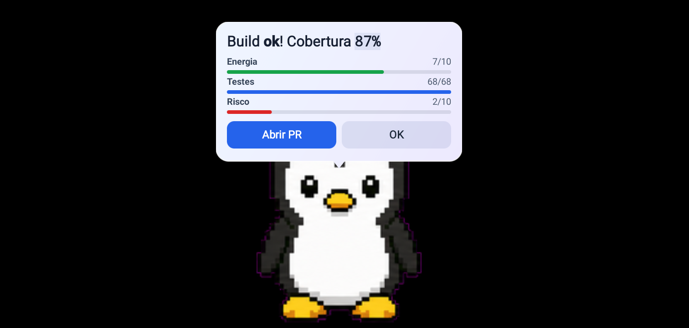
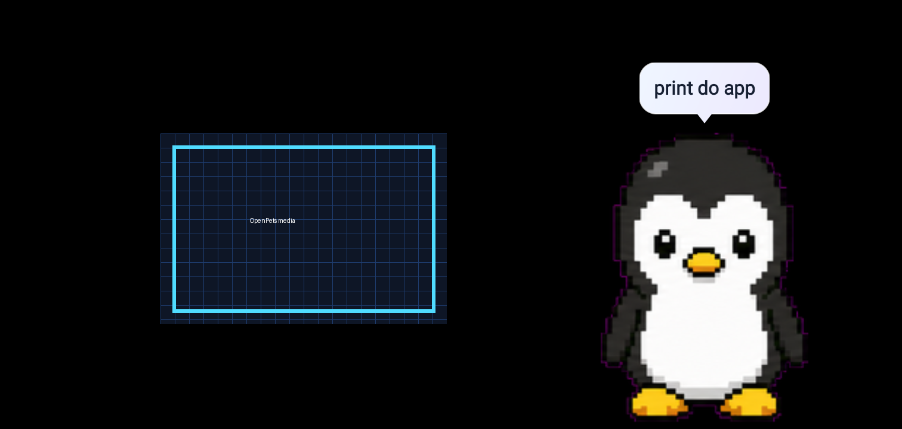
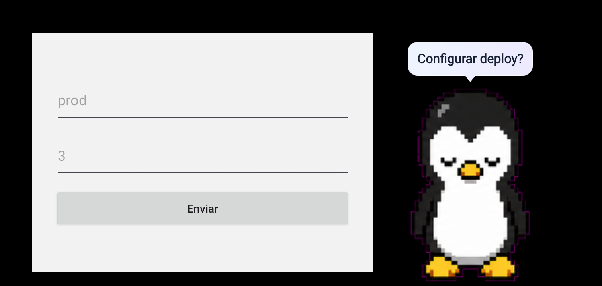
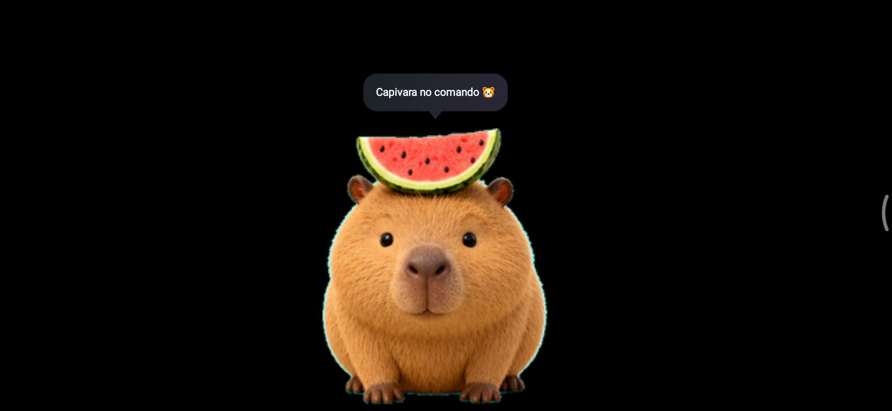
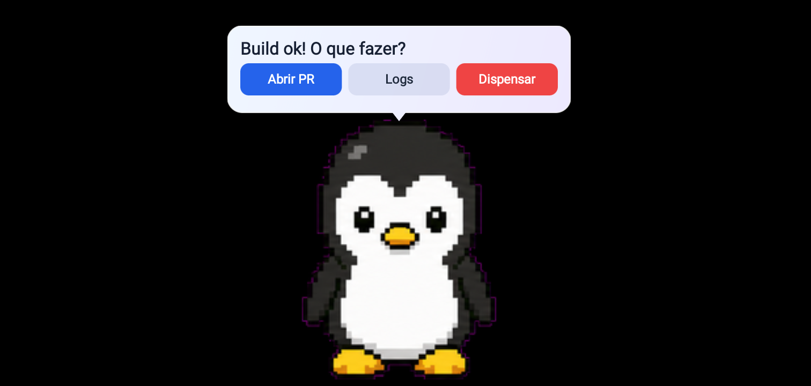

<div align="center">

# OpenPets Android

Vocabulary: share text to OpenPets to look up a definition or translation and show it on the pet.

**Turn an old phone or tablet into an always-on OpenPets companion.**

A community Android companion for [OpenPets](https://github.com/OpenPetsHQ/openpets) that shows your pet on screen and reacts — in real time — to what your coding agents are doing.

[](https://github.com/beneduzi/openpets-android/actions/workflows/android.yml)
[](LICENSE)
[](#)
[](#quick-start)
[](https://kotlinlang.org)
[](https://github.com/OpenPetsHQ/openpets)
[](#contributing)

[Quick start](#quick-start) · [Connect the MCP](#connect-the-openpets-mcp) · [Features](#features) · [Protocol](#protocols) · [FAQ](#faq)

</div>

---

## Why this exists

Your agents already tell you what they are doing — through logs, terminals, and tabs you have to watch. OpenPets Android turns a spare Android device into a **dedicated, glanceable companion**: it sits on your desk (or stays in your pocket), keeps the screen on, and mirrors your agents' state as a living pet with speech bubbles, progress bars, images, and buttons.

It speaks the OpenPets protocol directly, so it works with the OpenCode plugin, the OpenPets MCP server, and the `@open-pets/cli` — **no desktop app required on the phone's side**.

## Screenshots

<div align="center">

| Professor Hoot | Rich bubble | Media |
| :-: | :-: | :-: |
|  |  |  |

| Form | Melon Capybara | Actions |
| :-: | :-: | :-: |
|  |  |  |

</div>

## Features

| | |
| --- | --- |
| 🐾 **Animated pet** | Spritesheet pet (8×9 grid, 192×208 px frames) with per-reaction animations and idle wandering. Eleven reactions: `idle`, `thinking`, `working`, `editing`, `running`, `testing`, `waiting`, `waving`, `success`, `error`, `celebrating`. |
| 💬 **Rich bubbles** | Markdown text, up to 4 HUD progress bars, up to 4 action buttons (`url` opens, `callbackUrl` POSTs), pinned bubbles with stable IDs, and forms (up to 4 inputs → POST to a `submitUrl`). |
| 🖼️ **Media** | `pet.showMedia` pushes an image **inline as base64** (no network on the device) or via an HTTP(S) URL — png/jpg/jpeg/webp/gif, ~10 MB, with caption, reaction, duration, and optional `clickUrl`. |
| 🎨 **Per-project identity** | The agent's `source` gives each project its own accent color and label. |
| 🔔 **Sound, haptics & voice** | Beep or a custom sound, vibration, text-to-speech, and system notifications — each independently toggleable. |
| 🧩 **Pets** | Five built-in pets (Professor Hoot, Tux, Melon Capybara, Lazy Raccoon, Mellow Duck), import from `.zip`/folder, or browse the online catalog. Supports `pets.install` / `pets.install-local`. |
| 🤝 **Optional leases** | A single-owner lease (`status.leases`) keeps multiple agents from fighting over the pet. |
| 📺 **Always-on ready** | Foreground service, keep-screen-on, immersive mode, start on boot, and the official OpenPets icon. |

## Quick start

**Requirements:** JDK 17, Android SDK platform 34 + build-tools 34, and a `local.properties` file with `sdk.dir`.

```bash
# Build the debug APK
./gradlew :app:assembleDebug

# Install it on a connected device
adb install -r app/build/outputs/apk/debug/app-debug.apk
```

Launch the app: the pet appears and a foreground service starts the servers. **Long-press the pet** to open Settings, then note the **device IP** and the **IPC / Remote tokens**. For permissions, always-on setup, and networking, see the **[Installation & setup guide](docs/INSTALLATION.md)**.

## Connect the OpenPets MCP

Agents reach the device over your LAN. The recommended path is the local **IPC** protocol via a *discovery file*; MCP and the CLI can also use the **Remote** protocol as a fallback. Full reference: **[Agent integration](docs/AGENT-INTEGRATION.md)**.

### 1. Generate a discovery file

```bash
tools/write-discovery.sh <DEVICE_IP> <IPC_TOKEN>
# → ~/.config/opencode/openpets-discovery.json
```

The `OPENPETS_DISCOVERY_FILE` environment variable is used by **both** the OpenCode plugin and the MCP server.

### 2. Point your MCP client at the device

**Generic MCP client config**

```json
{
  "mcpServers": {
    "openpets": {
      "type": "stdio",
      "command": "npx",
      "args": ["-y", "@open-pets/mcp@latest", "--pet", "default"]
    }
  }
}
```

**OpenCode** — add this entry to `~/.config/opencode/opencode.jsonc`:

```jsonc
"openpets": {
  "type": "local",
  "command": ["npx", "-y", "@open-pets/cli@4.0.0", "mcp", "--pet", "default"],
  "environment": {
    "OPENPETS_DISCOVERY_FILE": "/home/<user>/.config/opencode/openpets-discovery.json"
  },
  "enabled": true
}
```

The MCP server exposes `openpets_status`, `openpets_react`, and `openpets_say`. Diagnose a setup with `npx @open-pets/cli status` and `npx @open-pets/cli doctor`.

> **Remote fallback (MCP / CLI only):** set `OPENPETS_REMOTE_ENDPOINT` (e.g. `tcp://192.168.0.14:18421`) and `OPENPETS_REMOTE_TOKEN`. The OpenCode plugin does **not** support Remote.

### Verify it works

```bash
node tools/send-reaction.mjs <host> <port> <ipcToken> react editing
node tools/send-reaction.mjs <host> <port> <ipcToken> say "Running tests" testing
node tools/send-media.mjs    <host> <port> <ipcToken> ./print.png "build finished" 8000
```

## Architecture

```
┌───────────────────────────────┐                         ┌──────────────────────────────┐
│  Agent                        │      TCP over LAN       │  OpenPets Android            │
│  • OpenCode plugin            │  IPC 18420 / Remote 18421│  foreground service          │
│  • OpenPets MCP server        │ ──────────────────────▶ │  pet · bubbles · media       │
│  • @open-pets/cli             │  react · say · media     │  always-on · keep screen on  │
└───────────────────────────────┘                         └──────────────────────────────┘
```

## Protocols

The app is the OpenPets **target**: it listens for one-line JSON requests and validates them against a per-protocol token.

| Protocol | Transport | Methods |
| --- | --- | --- |
| IPC `openpets-ipc` v1 | TCP, line-delimited JSON | `hello`, `status`, `pets.list`, `pets.install`, `pets.install-local`, `lease.acquire`, `lease.heartbeat`, `lease.release`, `pet.react`, `pet.say`, `pet.showMedia`, `pet.bubbleDismiss`, `pet.move`, `pet.setScale`, `pet.hide`, `pet.show`, `notify`, `status.publish` |
| Remote `openpets-remote` v1 | Raw TCP, one request per socket | `status`, `pet.react`, `pet.say` |
| WebSocket `openpets-ws` v1 *(experimental)* | `ws://` LAN, opt-in (disabled by default) | streams pet/companion events; accepts the IPC command surface |

- **Request** `{ id, version:1, token, method, params }` · **success** `{ id, ok:true, result }` · **error** `{ id, ok:false, error:{code,message} }`
- Leases have a 15-second TTL. Remote is capped at 4 KB per request and rate-limited to 30 requests per minute.

### Reaction → animation map

| Reaction | Animation |
| --- | --- |
| `idle` | `idle` |
| `thinking` | `review` |
| `working` / `editing` / `running` | `running` |
| `testing` / `waiting` | `waiting` |
| `waving` | `waving` |
| `success` / `celebrating` | `jumping` |
| `error` | `failed` |

## OpenPets Desktop vs OpenPets Android

The Android app is a **companion**, not a port of the desktop app. It focuses on presence and glanceability.

| Capability | OpenPets Desktop | OpenPets Android |
| --- | :-: | :-: |
| Always-on pet display | ✅ (on your PC) | ✅ (on a spare device) |
| Reactions, speech, rich bubbles, forms, media | ✅ | ✅ |
| Runs without a PC | ❌ | ✅ |
| Native plugins (e.g. Reminders, Water Reminder) | ✅ | ❌ |
| Pet movement/physics, panels, speech-to-text | ✅ | ❌ |

## FAQ

<details>
<summary><strong>Does it need the desktop app running?</strong></summary>

No. The companion implements the OpenPets protocol directly, so agents connect straight to the device over the LAN.
</details>

<details>
<summary><strong>Is it secure?</strong></summary>

Traffic is **unencrypted**, and IPC only accepts private/local IPv4 addresses. Use it on a trusted LAN or VPN, and treat the per-protocol tokens as secrets. Remote mode is a fallback for MCP/CLI and is disabled-by-default in upstream tooling.
</details>

<details>
<summary><strong>Does media require internet access?</strong></summary>

No. `pet.showMedia` can push the image **inline as base64**, so the device needs only the existing connection — no network fetch.
</details>

<details>
<summary><strong>What are the tokens for?</strong></summary>

They authenticate every request. They are generated once, stay stable across restarts, and can be copied (or edited) from the in-app Settings. Use the IPC token for the discovery file and the Remote token for remote mode.
</details>

<details>
<summary><strong>Will an old phone work?</strong></summary>

Yes — `minSdk` is 24 (Android 7.0+). The app is designed to repurpose older hardware.
</details>

<details>
<summary><strong>The screen must stay on — is that expected?</strong></summary>

Yes. This is an always-on companion: it holds a wake lock, keeps the screen on, and can start on boot. Disable battery optimization for it so Android does not kill the service.
</details>

## Development

**Prerequisites:** JDK 17, Android SDK platform 34 and build-tools 34, and `local.properties` configured with `sdk.dir`.

```bash
./gradlew :protocol:test        # unit + server integration tests
./gradlew :app:assembleDebug    # app/build/outputs/apk/debug/app-debug.apk
./gradlew :app:assembleRelease  # app/build/outputs/apk/release/app-release.apk
```

The release APK is signed with the debug key so it can be sideloaded. CI builds it on every push and attaches it to GitHub Releases on `v*` tags.

### Repository layout

| Path | Contents |
| --- | --- |
| `app/` | UI (Canvas pet, rich bubbles, media/forms), network service, settings, always-on behaviour. |
| `protocol/` | Pure Kotlin (JVM-testable): IPC/remote protocol, validators, TCP servers, reaction mapping. |
| `tools/` | Helper scripts for discovery and sending reactions/media. |
| `docs/` | Installation and agent-integration guides. |
| `integrations/` | Host-side integrations: the OpenCode plugin, a host-plugin client + template (`host-plugins/`), and the host-status sender. |

## Contributing

Issues and pull requests are welcome. Please keep changes focused, run `./gradlew :protocol:test` before opening a PR, and match the existing code style.

## License

MIT © 2026 Gustavo Beneduzi. See [LICENSE](LICENSE).

OpenPets and its artwork belong to the [OpenPetsHQ project](https://github.com/OpenPetsHQ/openpets) (MIT); attribution is retained.
